<picture>
  <source media="(prefers-color-scheme: dark)" srcset=".github/assets/header-dunkel.svg">
  
</picture>

     

<h3 align="center">Your AI forgets you every morning. These repos fix that.</h3>

Everything that lets agents remember and look things up: memory layers, coding-agent memory, RAG engines, vector databases, rerankers, document parsers and OCR, Obsidian second brains, LLM wikis and research agents. Picked from 6,600+ starred repos while building the memory of myOS, each filed by the job it does.

## Start here

No time for 289 repos? Start with these 4, one per role. Add the rest when you feel the gap.

| Role | Pick | Why |
|:--|:--|:--|
| **Parse** | [docling](https://github.com/docling-project/docling) `★ 69.8k` | Turns PDFs, Office files and HTML into clean input for LLMs |
| **Retrieve** | [ragflow](https://github.com/infiniflow/ragflow) `★ 93k` | Full RAG engine that fuses retrieval with agent features |
| **Remember** | [mem0](https://github.com/mem0ai/mem0) `★ 68k` | Drop-in memory layer so agents and apps keep their context |
| **Research** | [gpt-researcher](https://github.com/assafelovic/gpt-researcher) `★ 30.3k` | Autonomous agent that runs deep research with any LLM provider |

<picture>
  <source media="(prefers-color-scheme: dark)" srcset=".github/assets/map-dunkel.svg">
  
</picture>

## Contents

- [Agent memory](#agent-memory) · 48 [Memory layers and services](#memory-layers-and-services) · [Memory for coding agents](#memory-for-coding-agents) · [Context layers and stores](#context-layers-and-stores)
- [RAG](#rag) · 68 [RAG engines and platforms](#rag-engines-and-platforms) · [Graph and reasoning RAG](#graph-and-reasoning-rag) · [Chat with your documents](#chat-with-your-documents) · [RAG frameworks, research and lists](#rag-frameworks-research-and-lists)
- [Vector search and embeddings](#vector-search-and-embeddings) · 63 [Vector databases](#vector-databases) · [Embedding models and servers](#embedding-models-and-servers) · [Rerankers and late interaction](#rerankers-and-late-interaction) · [Semantic and local search](#semantic-and-local-search)
- [Documents and capture](#documents-and-capture) · 26 [Document parsers](#document-parsers) · [OCR and layout models](#ocr-and-layout-models) · [Clipping, capture and screen memory](#clipping-capture-and-screen-memory)
- [Second brain and LLM wikis](#second-brain-and-llm-wikis) · 57 [Obsidian with AI](#obsidian-with-ai) · [LLM wikis](#llm-wikis) · [AI notebooks and knowledge apps](#ai-notebooks-and-knowledge-apps)
- [Research agents](#research-agents) · 27 [Deep research and answer engines](#deep-research-and-answer-engines) · [Autoresearch and AI scientists](#autoresearch-and-ai-scientists)

## Agent memory

Memory that survives the next session.

### Memory layers and services

- **[mem0](https://github.com/mem0ai/mem0)** `★ 68k` · **Top pick.** Drop-in memory layer that gives AI agents and apps context that persists.
- **[graphiti](https://github.com/getzep/graphiti)** `★ 32.3k` · **Top pick.** Builds real-time knowledge graphs that serve as memory for AI agents.
- **[mempalace](https://github.com/MemPalace/mempalace)** `★ 59.8k` · Free, open-source AI memory system with ChromaDB storage and an MCP server.
- **[hindsight](https://github.com/vectorize-io/hindsight)** `★ 55.5k` · Agent memory system that helps agents learn over time instead of only recalling chat history.
- **[cognee](https://github.com/topoteretes/cognee)** `★ 32.9k` · Open-source AI memory platform that gives agents persistent long-term memory.
- **[letta](https://github.com/letta-ai/letta)** `★ 25.3k` · Platform for stateful agents with advanced memory that learn and self-improve over time.
- **[memvid](https://github.com/memvid/memvid)** `★ 17.2k` · Serverless single-file memory layer for AI agents that replaces complex RAG pipelines.
- **[memU](https://github.com/NevaMind-AI/memU)** `★ 14.6k` · Personal memory shared across agents, with MCP and agent skills support.
- **[EverOS](https://github.com/EverMind-AI/EverOS)** `★ 13.7k` · Portable, local-first memory layer for every AI agent, stored as Markdown.
- **[MemOS](https://github.com/MemTensor/MemOS)** `★ 12.2k` · Memory OS for LLMs and agents with persistent memory, hybrid retrieval and skill reuse.
- **[MemoryBear](https://github.com/SuanmoSuanyangTechnology/MemoryBear)** `★ 8.9k` · Memory layer that equips AI with human-like memory capability.
- **[utopia](https://github.com/deeplethe/utopia)** `★ 8.6k` · Open-source enterprise world model built on a bitemporal knowledge graph.
- **[honcho](https://github.com/plastic-labs/honcho)** `★ 7.8k` · Memory library for building stateful agents.
- **[LongMemory](https://github.com/CaviraOSS/LongMemory)** `★ 4.5k` · Local persistent memory store for LLM apps such as Claude Desktop, Copilot and Codex.
- **[agent-memory](https://github.com/tigerless-labs/agent-memory)** `★ 4.4k` · Long-term memory runtime for AI agents that keeps plain Markdown as the source of truth.
- **[leviathan](https://github.com/elstongun/leviathan)** `★ 869` · Single static binary that gives agents deep memory over large datasets of records.
- **[symbiotic-ai](https://github.com/lout33/symbiotic-ai)** `★ 738` · Personal AI agent that keeps memory in plain Markdown files and challenges your thinking.
- **[brainapi2](https://github.com/Lumen-Labs/brainapi2)** `★ 547` · Knowledge-graph-powered AI memory layer that turns unstructured data into structured knowledge.
- **[cortexdb](https://github.com/liliang-cn/cortexdb)** `★ 472` · AI memory and knowledge graph in one SQLite file, with vectors, RAG and MCP tools in pure Go.
- **[graph-memory-starter](https://github.com/Glitch-Cat-Club/graph-memory-starter)** `★ 264` · Knowledge-graph memory for assistants on three SQLite tables with one recursive query.
- **[mcp-memory](https://github.com/fellowgeek/mcp-memory)** `★ 221` · MCP server that gives AI persistent long-term memory with SQLite FTS5 search.
- **[Sibyl-Memory](https://github.com/Sibyl-Labs/Sibyl-Memory)** `★ 175` · File-based long-term memory for AI agents, with SDK, CLI, MCP server and Hermes adapter.
- **[AutoMemory](https://github.com/HKUDS/AutoMemory)** `★ 25` · Automatically builds the memory an agent needs.

### Memory for coding agents

- **[claude-mem](https://github.com/thedotmack/claude-mem)** `★ 104k` · **Top pick.** Captures what an agent does each session, compresses it and feeds the context into later sessions.
- **[agentmemory](https://github.com/rohitg00/agentmemory)** `★ 30k` · Persistent memory for AI coding agents across Claude Code, Codex, Cursor, OpenCode and more.
- **[ai-memory](https://github.com/akitaonrails/ai-memory)** `★ 14.3k` · Long-term memory for agent coding CLIs, with handoff between different agent vendors.
- **[engram](https://github.com/Gentleman-Programming/engram)** `★ 7.7k` · Persistent memory for coding agents as a Go binary with SQLite, MCP server and CLI.
- **[basic-memory](https://github.com/basicmachines-co/basic-memory)** `★ 4.4k` · Local-first Markdown memory over MCP, so you never re-explain your project to your AI.
- **[Continuous-Claude-v3](https://github.com/parcadei/Continuous-Claude-v3)** `★ 3.9k` · Context management for Claude Code using hooks, ledgers and handoffs to keep state.
- **[claude-subconscious](https://github.com/letta-ai/claude-subconscious)** `★ 2.9k` · Background agent from Letta that learns from Claude Code sessions and whispers guidance back.
- **[memsearch](https://github.com/zilliztech/memsearch)** `★ 2.8k` · Persistent memory layer for AI agents such as Claude Code and Codex, backed by Markdown and Milvus.
- **[claude-supermemory](https://github.com/supermemoryai/claude-supermemory)** `★ 2.8k` · Gives Claude Code persistent memory through supermemory so it learns over time.
- **[openwolf](https://github.com/cytostack/openwolf)** `★ 2.4k` · Portable project memory across Claude Code, Codex and OpenCode, with token accounting.
- **[claude-memory-compiler](https://github.com/coleam00/claude-memory-compiler)** `★ 1.3k` · Gives Claude Code a memory that evolves with the codebase by capturing sessions through hooks.
- **[claude-code-memory-setup](https://github.com/lucasrosati/claude-code-memory-setup)** `★ 1k` · Claude Code setup with Obsidian and Graphify for persistent memory and fewer tokens per session.
- **[okf-agent-memory](https://github.com/okf-memory/okf-agent-memory)** `★ 844` · Git-native persistent memory for AI coding agents with fast in-memory BM25 search.
- **[evolving-agents](https://github.com/EvolvingAgentsLabs/evolving-agents)** `★ 457` · Director agent that plans from CLAUDE.md and memory, delegates to Claude Code and versions lessons.
- **[agent-memory-vault](https://github.com/mcncarl/agent-memory-vault)** `★ 340` · Markdown-first shared memory vault for Claude Code and Codex with SQLite, Zvec, Git and audit.
- **[Mimir](https://github.com/orneryd/Mimir)** `★ 288` · Open, customizable memory bank with semantic vector search over locally indexed files.
- **[kuato](https://github.com/alexknowshtml/kuato)** `★ 181` · Skill that helps Claude Code and other agents recall what you discussed earlier.
- **[openmemory](https://github.com/mem0ai/openmemory)** `★ 99` · CLI and TUI that port AI coding sessions across Claude Code, Codex and OpenCode.
- **[spookling-memory](https://github.com/Spookling/spookling-memory)** `★ 2` · Long-term memory plugin for Claude Code and Codex: a never-edited log, dated facts, a timeline.
- **[claude-wrap-command](https://github.com/ceoguy/claude-wrap-command)** `★ 1` · Claude Code slash command that closes a session into an Obsidian vault so the next needs no recap.

### Context layers and stores

- **[OpenViking](https://github.com/volcengine/OpenViking)** `★ 41.1k` · Context database that unifies agent memory, knowledge RAG and skills.
- **[TencentDB-Agent-Memory](https://github.com/TencentCloud/TencentDB-Agent-Memory)** `★ 30.1k` · Team-level memory hub for AI agents, built from conversations, docs and code.
- **[trustgraph](https://github.com/trustgraph-ai/trustgraph)** `★ 2.8k` · Governance platform for agents, knowledge and context, built around context graphs.
- **[ultracontext](https://github.com/ultracontext/ultracontext)** `★ 425` · Open source context layer that auto-captures and shares agents' context everywhere.
- **[istoria-ai](https://github.com/anaisbetts/istoria-ai)** `★ 1` · TypeScript tool that renders context from your life for AI models.

<a href="#contents">back to contents</a>

## RAG

Answers grounded in your own documents.

### RAG engines and platforms

- **[ragflow](https://github.com/infiniflow/ragflow)** `★ 93k` · **Top pick.** Open-source RAG engine that fuses retrieval with agent features into a context layer for LLMs.
- **[quivr](https://github.com/The-Vibe-Company/quivr)** `★ 39.6k` · Engine that turns continuous content streams into search and monitoring with hybrid retrieval.
- **[WeKnora](https://github.com/Tencent/WeKnora)** `★ 35.8k` · LLM knowledge platform that turns documents into queryable RAG and a reasoning agent.
- **[RAG-Anything](https://github.com/HKUDS/RAG-Anything)** `★ 24.3k` · All-in-one multimodal RAG framework.
- **[DocsGPT](https://github.com/arc53/DocsGPT)** `★ 18.3k` · Private AI platform for agents, assistants and enterprise search with a built-in agent builder.
- **[llmware](https://github.com/llmware-ai/llmware)** `★ 14.8k` · Framework for building enterprise RAG pipelines with small, specialized models.
- **[PixelRAG](https://github.com/StarTrail-org/PixelRAG)** `★ 10.7k` · Scalable pixel-native search for multimodal RAG that replaces web parsing with vision models.
- **[UltraRAG](https://github.com/OpenBMB/UltraRAG)** `★ 5.7k` · Low-code MCP framework for building complex RAG pipelines.
- **[ragapp](https://github.com/ragapp/ragapp)** `★ 4.4k` · Dockerized agentic RAG app for enterprises, built on LlamaIndex.
- **[MemoRAG](https://github.com/qhjqhj00/MemoRAG)** `★ 2.3k` · RAG framework with a memory-based data interface for all-purpose applications.
- **[ragbits](https://github.com/deepsense-ai/ragbits)** `★ 1.7k` · Building blocks for GenAI apps covering document search, agents, evaluation and guardrails.
- **[dsRAG](https://github.com/D-Star-AI/dsRAG)** `★ 1.6k` · Retrieval engine for RAG over unstructured data.
- **[ApeRAG](https://github.com/apecloud/ApeRAG)** `★ 1.3k` · GraphRAG platform with multimodal indexing, agents and MCP support, deployable on Kubernetes.
- **[raglite](https://github.com/superlinear-ai/raglite)** `★ 1.2k` · Python toolkit for retrieval-augmented generation on DuckDB or PostgreSQL.
- **[rag-api](https://github.com/LibreChat-AI/rag-api)** `★ 918` · ID-based RAG API on FastAPI with LangChain and PostgreSQL pgvector.
- **[haiku.rag](https://github.com/ggozad/haiku.rag)** `★ 642` · Agentic RAG for local document search with hybrid retrieval, reranking and an MCP server.
- **[industrial-general-rag](https://github.com/phoenix-zhou/industrial-general-rag)** `★ 597` · RAG system that combines FAQ matching, intent recognition and dynamic adaptive retrieval.
- **[knowledge-rag](https://github.com/lyonzin/knowledge-rag)** `★ 300` · Local RAG MCP server for Claude Code with hybrid search and cross-encoder reranking.
- **[RustyRAG](https://github.com/RustyRAG/RustyRAG)** `★ 148` · Rust RAG API with hybrid HNSW dense and BM25 sparse search plus cross-encoder reranking.
- **[OpenRag](https://github.com/incidentfox/OpenRag)** `★ 43` · Multi-strategy RAG system that combines RAPTOR hierarchical retrieval with a knowledge graph.
- **[ollama-rag-reranker](https://github.com/00200200/ollama-rag-reranker)** `★ 13` · Interactive RAG command line with Ollama embeddings, an HNSW index and optional reranking.

### Graph and reasoning RAG

- **[LightRAG](https://github.com/HKUDS/LightRAG)** `★ 40.4k` · **Top pick.** Simple and fast retrieval-augmented generation over knowledge graphs, from EMNLP 2025.
- **[PageIndex](https://github.com/VectifyAI/PageIndex)** `★ 39.9k` · Document index for vectorless, reasoning-based RAG.
- **[graphrag](https://github.com/microsoft/graphrag)** `★ 36.5k` · Modular graph-based retrieval-augmented generation system from Microsoft.
- **[HippoRAG](https://github.com/OSU-NLP-Group/HippoRAG)** `★ 4.1k` · RAG framework modeled on human long-term memory so LLMs keep integrating new knowledge.
- **[GraphRAG-Local-UI](https://github.com/severian42/GraphRAG-Local-UI)** `★ 2.3k` · API and apps for running GraphRAG on local LLMs: indexing, prompt tuning, querying and chat.
- **[raptor](https://github.com/parthsarthi03/raptor)** `★ 1.8k` · Official implementation of RAPTOR, recursive abstractive processing for tree-organized retrieval.
- **[NexusRAG](https://github.com/LeDat98/NexusRAG)** `★ 528` · Hybrid RAG with vector search, a LightRAG knowledge graph, reranking and Docling parsing.

### Chat with your documents

- **[kotaemon](https://github.com/Cinnamon/kotaemon)** `★ 25.8k` · **Top pick.** Open-source RAG-based tool for chatting with your documents.
- **[private-gpt](https://github.com/zylon-ai/private-gpt)** `★ 57.6k` · API layer for private AI apps on local models with RAG, tools, MCP and text-to-SQL.
- **[localGPT](https://github.com/PromtEngineer/localGPT)** `★ 22.2k` · Private chat with your documents on your own device using GPT models, with no data leaving it.
- **[rags](https://github.com/run-llama/rags)** `★ 6.5k` · Builds a ChatGPT-style assistant over your own data using natural language.
- **[ChatFiles](https://github.com/guangzhengli/ChatFiles)** `★ 3.3k` · Document chatbot that answers questions over multiple files using GPT and embeddings.
- **[rag-web-ui](https://github.com/rag-web-ui/rag-web-ui)** `★ 3.3k` · Web chat system that answers questions over your documents with RAG.
- **[paul-graham-gpt](https://github.com/mckaywrigley/paul-graham-gpt)** `★ 2.7k` · Question answering over Paul Graham's essays using retrieval-augmented generation.
- **[CORTEX-AI-SUPER-RAG](https://github.com/SaiAkhil066/CORTEX-AI-SUPER-RAG)** `★ 2k` · Enterprise retrieval and knowledge assistant that helps teams find accurate answers in company data.
- **[rag-stack](https://github.com/finic-ai/rag-stack)** `★ 1.6k` · Private ChatGPT alternative hosted in your VPC and connected to your organization's knowledge.
- **[Local_Pdf_Chat_RAG](https://github.com/weiwill88/Local_Pdf_Chat_RAG)** `★ 957` · Python RAG reference for chatting with local PDFs using FAISS, BM25, reranking and Gradio.
- **[document-chat-system](https://github.com/watat83/document-chat-system)** `★ 148` · Open-source platform for chatting with documents using semantic search, RAG and many AI providers.
- **[production-rag-assistant](https://github.com/aieng-abdullah/production-rag-assistant)** `★ 65` · RAG assistant for legal and academic documents that cites a source chunk for each claim.
- **[convex-ai-chat](https://github.com/convex/convex-ai-chat)** `★ 41` · Example AI chat bot with vector search that you can add to an existing website.
- **[team-knowledge-agent](https://github.com/coleam00/team-knowledge-agent)** `★ 4` · Knowledge agent for a team's code and docs, built by an AI Software Factory with Port.

### RAG frameworks, research and lists

- **[llama_index](https://github.com/run-llama/llama_index)** `★ 52.7k` · Document processing platform and data framework for building LLM applications.
- **[RAG_Techniques](https://github.com/NirDiamant/RAG_Techniques)** `★ 30.1k` · Notebook showcase of advanced retrieval-augmented generation techniques.
- **[all-in-rag](https://github.com/datawhalechina/all-in-rag)** `★ 12.7k` · Full-stack guide to RAG for large language model application development.
- **[production-agentic-rag-course](https://github.com/jamwithai/production-agentic-rag-course)** `★ 10k` · Course for building a production agentic RAG system.
- **[langchain-ai/rag-from-scratch](https://github.com/langchain-ai/rag-from-scratch)** `★ 9.6k` · Tutorial notebooks that build retrieval-augmented generation from scratch.
- **[agentic-rag-for-dummies](https://github.com/GiovanniPasq/agentic-rag-for-dummies)** `★ 4.3k` · Modular agentic RAG built with LangGraph for learning RAG agents.
- **[bRAG-langchain](https://github.com/bragai/bRAG-langchain)** `★ 4.2k` · Guide to everything you need to build your own RAG application with LangChain.
- **[FlashRAG](https://github.com/RUC-NLPIR/FlashRAG)** `★ 3.6k` · Python toolkit for efficient RAG research, with benchmarks and datasets.
- **[examples](https://github.com/pinecone-io/examples)** `★ 3k` · Jupyter notebooks for hands-on work with Pinecone vector databases.
- **[Awesome-GraphRAG](https://github.com/DEEP-PolyU/Awesome-GraphRAG)** `★ 2.7k` · Curated list of surveys, papers, benchmarks and open-source projects on graph-based RAG.
- **[rag-cookbooks](https://github.com/athina-ai/rag-cookbooks)** `★ 2.6k` · Notebooks with advanced techniques for retrieval-augmented generation systems.
- **[RAG-Challenge-2](https://github.com/IlyaRice/RAG-Challenge-2)** `★ 2.5k` · Implementation of the RAG system that won all categories in Enterprise RAG Challenge 2.
- **[self-rag](https://github.com/AkariAsai/self-rag)** `★ 2.4k` · Original code for a method that learns to retrieve, generate and critique through self-reflection.
- **[RAGHub](https://github.com/Andrew-Jang/RAGHub)** `★ 2k` · Community-driven collection of RAG frameworks, projects and resources.
- **[AgenticRAG-Survey](https://github.com/asinghcsu/AgenticRAG-Survey)** `★ 1.7k` · Survey of Agentic RAG, retrieval-augmented generation systems enhanced with LLM agents.
- **[Awesome-LLM-RAG-Application](https://github.com/lizhe2004/Awesome-LLM-RAG-Application)** `★ 1.7k` · List of resources on LLM applications built with the RAG pattern.
- **[pguso/rag-from-scratch](https://github.com/pguso/rag-from-scratch)** `★ 1.6k` · Tutorial that builds RAG from scratch with local LLMs to explain embeddings and vector search.
- **[Controllable-RAG-Agent](https://github.com/NirDiamant/Controllable-RAG-Agent)** `★ 1.6k` · Advanced RAG agent for complex question answering, built with LangChain and LangGraph.
- **[ragbuilder](https://github.com/KruxAI/ragbuilder)** `★ 1.5k` · Unmaintained toolkit that tunes RAG settings such as chunking and scores each setup on a test set.
- **[Awesome-RAG](https://github.com/Danielskry/Awesome-RAG)** `★ 1.4k` · Curated list of retrieval-augmented generation applications in generative AI.
- **[Awesome-LLM-RAG](https://github.com/jxzhangjhu/Awesome-LLM-RAG)** `★ 1.4k` · Curated list of advanced retrieval-augmented generation methods for LLMs.
- **[RAGxplorer](https://github.com/gabrielchua/RAGxplorer)** `★ 1.2k` · Interactive Streamlit tool to visualise a RAG pipeline.
- **[Rankify](https://github.com/DataScienceUIBK/Rankify)** `★ 684` · Python toolkit for retrieval, re-ranking and retrieval-augmented generation.
- **[VectorHub](https://github.com/superlinked/VectorHub)** `★ 533` · Deprecated learning hub with materials on adding vector retrieval to an ML stack.
- **[chat-with-everything](https://github.com/S0NM/chat-with-everything)** `★ 51` · Article series for developers learning to build chat-with-everything apps with LLMs.
- **[Reliable_RAG](https://github.com/Lokesh-Chimakurthi/Reliable_RAG)** `★ 42` · RAG pipeline using semantic double-merging chunking, Qdrant hybrid search and ColBERT reranking.

<a href="#contents">back to contents</a>

## Vector search and embeddings

The index under every memory.

### Vector databases

- **[qdrant](https://github.com/qdrant/qdrant)** `★ 35.3k` · **Top pick.** Vector database and vector search engine written in Rust.
- **[milvus](https://github.com/milvus-io/milvus)** `★ 46.5k` · Cloud-native vector database for scalable vector similarity search.
- **[faiss](https://github.com/facebookresearch/faiss)** `★ 41.2k` · Library for efficient similarity search and clustering of dense vectors.
- **[pgvector](https://github.com/pgvector/pgvector)** `★ 23.5k` · Open-source vector similarity search for Postgres.
- **[turbovec](https://github.com/RyanCodrai/turbovec)** `★ 17.4k` · Rust vector index built on TurboQuant, with Python bindings.
- **[weaviate](https://github.com/weaviate/weaviate)** `★ 16.9k` · Open-source vector database that stores both objects and vectors.
- **[zvec](https://github.com/alibaba/zvec)** `★ 16.2k` · Lightweight, in-process vector database.
- **[sqlite-vec](https://github.com/asg017/sqlite-vec)** `★ 8.2k` · Vector search extension for SQLite that runs anywhere.
- **[lance](https://github.com/lance-format/lance)** `★ 7.2k` · Open lakehouse format for multimodal AI with fast random access and vector search.
- **[SPTAG](https://github.com/microsoft/SPTAG)** `★ 5k` · Distributed approximate nearest neighbor library for building and serving vector indexes.
- **[infiniflow/infinity](https://github.com/infiniflow/infinity)** `★ 4.7k` · AI-native database for LLM apps with hybrid search over dense and sparse vectors.
- **[RuVector](https://github.com/ruvnet/RuVector)** `★ 4.6k` · Rust vector and graph neural network database for agent memory and real-time decisions.
- **[vearch](https://github.com/vearch/vearch)** `★ 2.3k` · Distributed vector search for AI-native applications.
- **[pgvecto.rs](https://github.com/tensorchord/pgvecto.rs)** `★ 2.2k` · Postgres extension for scalable, low-latency and hybrid vector search.
- **[VectorChord](https://github.com/supervc-stack/VectorChord)** `★ 1.8k` · Disk-friendly vector search inside Postgres, successor to pgvecto.rs.
- **[awesome-vector-search](https://github.com/currentslab/awesome-vector-search)** `★ 1.6k` · Curated list of vector search libraries, services and research papers.
- **[pymilvus](https://github.com/milvus-io/pymilvus)** `★ 1.4k` · Python SDK for the Milvus vector database.
- **[qdrant-client](https://github.com/qdrant/qdrant-client)** `★ 1.4k` · Python client for the Qdrant vector search engine.
- **[sqlite-vector](https://github.com/sqliteai/sqlite-vector)** `★ 1.2k` · Cross-platform extension that adds vector search to embedded SQLite databases.
- **[VectorDBBench](https://github.com/zilliztech/VectorDBBench)** `★ 1.2k` · Benchmark for comparing the performance and cost-effectiveness of vector databases.
- **[NornicDB](https://github.com/orneryd/NornicDB)** `★ 920` · Low-latency graph and vector database with temporal MVCC and sub-millisecond HNSW search.
- **[vector-db-benchmark](https://github.com/qdrant/vector-db-benchmark)** `★ 375` · Framework for benchmarking vector search engines.
- **[VectorRAG.Net](https://github.com/likeslines-maker/VectorRAG.Net)** `★ 164` · Native .NET vector database library for semantic search and RAG.
- **[comet](https://github.com/0xnyn/comet)** `★ 133` · Go vector store with hybrid BM25 retrieval and HNSW, IVF or product-quantized indexes.

### Embedding models and servers

- **[sentence-transformers](https://github.com/huggingface/sentence-transformers)** `★ 19.2k` · **Top pick.** Library for text embeddings, retrieval and reranking.
- **[clip-as-service](https://github.com/jina-ai/clip-as-service)** `★ 12.8k` · Scalable service for embedding and ranking images and sentences with CLIP.
- **[FlagEmbedding](https://github.com/FlagOpen/FlagEmbedding)** `★ 12.3k` · Embedding models and tools for retrieval and retrieval-augmented LLMs.
- **[Chinese-Word-Vectors](https://github.com/Embedding/Chinese-Word-Vectors)** `★ 12.2k` · Collection of over 100 pretrained Chinese word vectors.
- **[GloVe](https://github.com/stanfordnlp/GloVe)** `★ 7.2k` · C software and data files for GloVe word vectors.
- **[text-embeddings-inference](https://github.com/huggingface/text-embeddings-inference)** `★ 5.1k` · Fast inference server for text embedding models.
- **[mteb](https://github.com/embeddings-benchmark/mteb)** `★ 3.5k` · Benchmark for evaluating embeddings across languages and modalities.
- **[michaelfeil/infinity](https://github.com/michaelfeil/infinity)** `★ 3k` · Serving engine for text embeddings, rerankers, CLIP, CLAP and ColPali models.
- **[clip-retrieval](https://github.com/rom1504/clip-retrieval)** `★ 2.8k` · Computes CLIP embeddings and builds a retrieval system on top of them.
- **[wordvectors](https://github.com/Kyubyong/wordvectors)** `★ 2.2k` · Pre-trained word vectors for more than 30 languages.
- **[instructor-embedding](https://github.com/xlang-ai/instructor-embedding)** `★ 2k` · Instruction-finetuned text embeddings: one embedder for any task (ACL 2023).
- **[sense2vec](https://github.com/explosion/sense2vec)** `★ 1.7k` · Contextually keyed word vectors from the spaCy team.
- **[fastText_multilingual](https://github.com/babylonhealth/fastText_multilingual)** `★ 1.2k` · Multilingual word vectors for 78 languages.
- **[fastembed-rs](https://github.com/anush008/fastembed-rs)** `★ 1.1k` · Rust library for generating vector embeddings and reranking locally.
- **[awesome-2vec](https://github.com/MaxwellRebo/awesome-2vec)** `★ 937` · Curated list of 2vec-style embedding models.
- **[visual-semantic-embedding](https://github.com/ryankiros/visual-semantic-embedding)** `★ 430` · Implementation of an image-sentence embedding method from a visual-semantic embeddings paper.
- **[vllm-factory](https://github.com/ddickmann/vllm-factory)** `★ 87` · Production inference for encoder models such as ColBERT, GLiNER and ColPali as vLLM plugins.
- **[open-retrievals](https://github.com/LongxingTan/open-retrievals)** `★ 71` · Toolkit for text embedding, retrieval, reranking and RAG built on Transformers.

### Rerankers and late interaction

- **[RAGatouille](https://github.com/AnswerDotAI/RAGatouille)** `★ 4k` · Library to use and train ColBERT late-interaction retrieval in any RAG pipeline.
- **[ColBERT](https://github.com/stanford-futuredata/ColBERT)** `★ 3.9k` · Neural search research code behind the ColBERT papers.
- **[rerankers](https://github.com/AnswerDotAI/rerankers)** `★ 1.6k` · Lightweight, low-dependency unified API for common reranking and cross-encoder models.
- **[RAG-Retrieval](https://github.com/NovaSearch-Team/RAG-Retrieval)** `★ 1.1k` · Unified fine-tuning of RAG retrieval models: embeddings, ColBERT and rerankers.
- **[FlashRank](https://github.com/PrithivirajDamodaran/FlashRank)** `★ 1k` · Lightweight re-ranking library for search and retrieval pipelines.
- **[pylate](https://github.com/lightonai/pylate)** `★ 899` · Library for training and running late-interaction retrieval models.
- **[rank_llm](https://github.com/castorini/rank_llm)** `★ 661` · Python toolkit for reproducible reranking research, focused on listwise LLM rerankers.
- **[PARADE](https://github.com/canjiali/PARADE)** `★ 97` · Code and data for reranking documents with BERT and ELECTRA using passage representations.
- **[awesome-rerankers](https://github.com/agentset-ai/awesome-rerankers)** `★ 78` · Curated list of reranking models, libraries and resources for retrieval-augmented generation.
- **[reranker-eval](https://github.com/agentset-ai/reranker-eval)** `★ 12` · Benchmarks rerankers in a RAG pipeline for accuracy, latency and LLM preference.

### Semantic and local search

- **[qmd](https://github.com/tobi/qmd)** `★ 30.7k` · **Top pick.** Mini CLI search engine for docs, knowledge bases and meeting notes that runs fully local.
- **[xerj](https://github.com/xerj-org/xerj)** `★ 17.3k` · Rust search engine and MCP server that indexes code, docs, logs and PDFs for agents.
- **[LEANN](https://github.com/StarTrail-org/LEANN)** `★ 13.6k` · Private RAG on your personal device with 97% storage savings, from an MLSys 2026 paper.
- **[DigUp](https://github.com/ARahim3/DigUp)** `★ 6k` · On-device search over photos, PDFs, documents, recordings, videos and code by what is in them.
- **[AutoRAG](https://github.com/Marker-Inc-Korea/AutoRAG)** `★ 5.2k` · Personal librarian agent that finds and organizes files on your computer.
- **[mgrep](https://github.com/mixedbread-ai/mgrep)** `★ 4.4k` · CLI that semantically greps code, images, PDFs and more.
- **[constella-desktop](https://github.com/Constella-OS/constella-desktop)** `★ 906` · Privately indexes local files and cloud apps on-device with a vector DB and knowledge graph.
- **[rag-skill](https://github.com/ConardLi/rag-skill)** `★ 723` · Skill dedicated to retrieval from a local knowledge base.
- **[SCM](https://github.com/allenv0/SCM)** `★ 509` · Multimodal visual memory search for macOS built on CLIP, SigLIP 2 and EmbeddingGemma 2.
- **[dotmd](https://github.com/inventivepotter/dotmd)** `★ 46` · Markdown knowledge base search combining semantic, BM25 keyword and knowledge graph retrieval.
- **[ShowMe](https://github.com/Simen1331/ShowMe)** `★ 37` · On-device Linux desktop search by what is in your files, a Rust port of DigUp for Omarchy.

<a href="#contents">back to contents</a>

## Documents and capture

Turn PDFs, pages and screens into knowledge.

### Document parsers

- **[docling](https://github.com/docling-project/docling)** `★ 69.8k` · **Top pick.** Document parser that gets your documents ready for gen AI.
- **[marker](https://github.com/datalab-to/marker)** `★ 40.7k` · **Top pick.** Converts PDF to Markdown and JSON quickly and with high accuracy.
- **[opendataloader-pdf](https://github.com/opendataloader-project/opendataloader-pdf)** `★ 30.1k` · PDF parser that produces AI-ready data and automates PDF accessibility.
- **[pdf-inspector](https://github.com/firecrawl/pdf-inspector)** `★ 19.8k` · Rust library that classifies PDFs as scanned or text-based and extracts their text.
- **[text-extract-api](https://github.com/CatchTheTornado/text-extract-api)** `★ 3.2k` · API that extracts and parses PDF, Word and PowerPoint files using OCR and Ollama models.
- **[ade-cli](https://github.com/landing-ai/ade-cli)** `★ 2.4k` · Official CLI for Agentic Document Extraction that parses documents into schema-shaped data.
- **[MarkEverythingDown](https://github.com/RoffyS/MarkEverythingDown)** `★ 349` · Converts PDFs, images, Word, PowerPoint, Excel and notebooks to Markdown with a multimodal LLM.
- **[markitdown-guide](https://github.com/robonuggets/markitdown-guide)** `★ 31` · Flattens a folder of docx, xlsx, pptx and pdf files into clean Markdown with Microsoft MarkItDown.

### OCR and layout models

- **[OCRmyPDF](https://github.com/ocrmypdf/OCRmyPDF)** `★ 35.2k` · Adds a searchable OCR text layer to scanned PDF files.
- **[LaTeX-OCR](https://github.com/lukas-blecher/LaTeX-OCR)** `★ 16.6k` · Vision transformer that converts images of equations into LaTeX code.
- **[nougat](https://github.com/facebookresearch/nougat)** `★ 10.1k` · Neural optical understanding model for academic documents.
- **[dots.ocr](https://github.com/studio-dots-ai/dots.ocr)** `★ 9.2k` · Single vision-language model for multilingual document layout parsing.
- **[Pix2Text](https://github.com/breezedeus/Pix2Text)** `★ 3.3k` · Python tool with small models that recognizes layouts, tables, formulas and text in images.
- **[deepseek_ocr_app](https://github.com/rdumasia303/deepseek_ocr_app)** `★ 1.9k` · Quick vibe-coded web app for trying DeepSeek OCR.
- **[Awesome-Scene-Text-Recognition](https://github.com/chongyangtao/Awesome-Scene-Text-Recognition)** `★ 1.7k` · Curated list of resources on scene text localization and recognition.
- **[OpenOCR](https://github.com/Topdu/OpenOCR)** `★ 1.5k` · Open-source toolkit for general OCR research and applications.
- **[CPS-OCR-Engine](https://github.com/AstarLight/CPS-OCR-Engine)** `★ 1.1k` · OCR engine from the SYSU DeepDriving Lab.
- **[Frog](https://github.com/TenderOwl/Frog)** `★ 918` · GNOME app that extracts text from images, videos and QR codes.

### Clipping, capture and screen memory

- **[screenpipe](https://github.com/screenpipe/screenpipe)** `★ 22.1k` · **Top pick.** Continuously records computer work as an open computer history that agents can use.
- **[Windrecorder](https://github.com/yuka-friends/Windrecorder)** `★ 4k` · Records your screen in small size so you can search and rewind what you saw.
- **[rem](https://github.com/jasonjmcghee/rem)** `★ 2.5k` · Records everything you view on your Mac locally and makes it searchable.
- **[fieldtheory-cli](https://github.com/afar1/fieldtheory-cli)** `★ 2.1k` · CLI that syncs your X bookmarks locally and makes them searchable context for coding agents.
- **[claude-chat-exporter](https://github.com/agarwalvishal/claude-chat-exporter)** `★ 734` · One-click exporter for Claude.ai chats to Markdown with artifacts and attachments.
- **[Recap](https://github.com/RecapAI/Recap)** `★ 717` · Open-source, privacy-first macOS app that summarizes meetings with AI.
- **[xhs-claude-skills](https://github.com/chenxiachan/xhs-claude-skills)** `★ 427` · Claude Code slash commands that extract Xiaohongshu posts into Obsidian notes.
- **[everything-capture](https://github.com/agentenatalie/everything-capture)** `★ 43` · Local-first capture of URLs, articles, posts and videos into a personal knowledge base.

<a href="#contents">back to contents</a>

## Second brain and LLM wikis

Notes that organize themselves and feed your agents.

### Obsidian with AI

- **[obsidian-skills](https://github.com/kepano/obsidian-skills)** `★ 50.3k` · **Top pick.** Agent skills that teach the Obsidian CLI and open formats such as Markdown, Bases and JSON Canvas.
- **[claude-obsidian](https://github.com/AgriciDaniel/claude-obsidian)** `★ 15.9k` · **Top pick.** Obsidian second brain where Claude reads, links and files any source you drop in.
- **[claudian](https://github.com/YishenTu/claudian)** `★ 15.8k` · Obsidian plugin that embeds Claude Code and Codex as an AI collaborator in your vault.
- **[obsidian-copilot](https://github.com/logancyang/obsidian-copilot)** `★ 7.9k` · Obsidian plugin that runs agents such as OpenCode, Codex and Claude Code inside your vault.
- **[obsidian-smart-connections](https://github.com/brianpetro/obsidian-smart-connections)** `★ 5.5k` · Obsidian plugin that surfaces related notes and excerpts with embeddings while you write.
- **[obsidian-mind](https://github.com/breferrari/obsidian-mind)** `★ 5.4k` · Self-organizing Obsidian vault that gives coding agents persistent memory.
- **[obsidian-second-brain](https://github.com/eugeniughelbur/obsidian-second-brain)** `★ 5k` · Persistent markdown memory in an Obsidian vault for Claude Code, Codex and other agents.
- **[mcp-obsidian](https://github.com/MarkusPfundstein/mcp-obsidian)** `★ 4.5k` · MCP server that connects agents to Obsidian through its REST API plugin.
- **[axton-obsidian-visual-skills](https://github.com/axtonliu/axton-obsidian-visual-skills)** `★ 3.7k` · Skill pack that makes Claude Code generate Canvas, Excalidraw and Mermaid diagrams from text.
- **[obsidian-agent-client](https://github.com/RAIT-09/obsidian-agent-client)** `★ 2.5k` · Obsidian plugin that runs Claude Code, Codex and Gemini CLI via the Agent Client Protocol.
- **[obsidian-smart-composer](https://github.com/glowingjade/obsidian-smart-composer)** `★ 2.3k` · Obsidian AI chat assistant with vault context, writing help and one-click edits.
- **[obsidian-textgenerator-plugin](https://github.com/nhaouari/obsidian-textgenerator-plugin)** `★ 2k` · Obsidian plugin that generates text with many AI providers.
- **[obsidian-claude-pkm](https://github.com/ballred/obsidian-claude-pkm)** `★ 1.9k` · Starter kit for a personal knowledge management system with Obsidian and Claude Code.
- **[obsidian-ai-orange-book](https://github.com/alchaincyf/obsidian-ai-orange-book)** `★ 1.5k` · Guide to rebuilding a second brain with Obsidian and Claude Code.
- **[chatgpt-md](https://github.com/bramses/chatgpt-md)** `★ 1.5k` · Obsidian plugin that brings ChatGPT chats into your notes.
- **[opencode-obsidian](https://github.com/mtymek/opencode-obsidian)** `★ 1.2k` · Obsidian plugin that embeds the OpenCode assistant in the sidebar.
- **[compass](https://github.com/AgriciDaniel/compass)** `★ 1k` · Obsidian vault template with an AI assistant for journaling, planning, habits and tasks.
- **[ai-memory-vault](https://github.com/jaredrhod/ai-memory-vault)** `★ 723` · Open-source system and templates that turn an Obsidian vault into persistent memory for an AI.
- **[obsidian-mcp-server](https://github.com/cyanheads/obsidian-mcp-server)** `★ 700` · MCP server to read, write, search and edit Obsidian vault notes, tags and frontmatter.
- **[personal-os-skills](https://github.com/ArtemXTech/personal-os-skills)** `★ 544` · Claude Code skills for working with an Obsidian vault.
- **[obsidian-github-copilot](https://github.com/Pierrad/obsidian-github-copilot)** `★ 499` · Obsidian plugin that bridges your vault to GitHub Copilot for chat and completion.
- **[katmer-code](https://github.com/hkcanan/katmer-code)** `★ 475` · Multi-provider AI sidebar for Obsidian covering Claude, Gemini, Codex and Antigravity.
- **[claude-obsidian-assistant](https://github.com/nemocake/claude-obsidian-assistant)** `★ 475` · Starter Obsidian vault wired for Claude Code so Claude can manage your notes.
- **[obsidian-mcp-plugin](https://github.com/aaronsb/obsidian-mcp-plugin)** `★ 467` · Obsidian plugin that runs an MCP server giving AI tools direct vault access.
- **[obsidian-claude-sidebar](https://github.com/derek-larson14/obsidian-claude-sidebar)** `★ 456` · Obsidian plugin that runs Claude Code, Codex and other agent CLIs in a sidebar.
- **[Obsidian-CLI-skill](https://github.com/pablo-mano/Obsidian-CLI-skill)** `★ 454` · Skill that teaches Claude Code and other agents to work with Obsidian from the command line.
- **[whisper-obsidian-plugin](https://github.com/nikdanilov/whisper-obsidian-plugin)** `★ 380` · Obsidian plugin that transcribes speech to text with Whisper.
- **[obsidian-claude-code-mcp](https://github.com/iansinnott/obsidian-claude-code-mcp)** `★ 358` · Connects Claude Code and other AI tools to Obsidian notes through MCP.
- **[obsidian-tars](https://github.com/TarsLab/obsidian-tars)** `★ 333` · Obsidian plugin that generates text from tag suggestions using services like DeepSeek and Claude.
- **[claude-canvas](https://github.com/AgriciDaniel/claude-canvas)** `★ 302` · Claude-driven visual production in Obsidian Canvas: slides, flowcharts, mood boards and graphs.
- **[second-brain](https://github.com/bradautomates/second-brain)** `★ 228` · Git-tracked Obsidian vault run by Claude Code that captures notes and gathers context.
- **[obsidian-knowledge-agent](https://github.com/Michael-OvO/obsidian-knowledge-agent)** `★ 206` · Agent pipeline that turns PDFs, slides and papers into structured Obsidian study notes.
- **[claude-adhd-skills](https://github.com/ravila4/claude-adhd-skills)** `★ 169` · Claude Code skills and hooks for Obsidian journaling, time nudges and staying organized.
- **[obsidian-gpt](https://github.com/jmilldotdev/obsidian-gpt)** `★ 118` · Obsidian plugin that gets language model completions through OpenRouter.
- **[autograph](https://github.com/smixs/autograph)** `★ 76` · Schema-as-code memory for AI agents in Obsidian with typed cards, entity dedup and link repair.
- **[dots-second-brain](https://github.com/AgriciDaniel/dots-second-brain)** `★ 5` · Source-backed Obsidian second brain for a personal agent running on OpenAI dots.
- **[plaude-api](https://github.com/jgatlit/plaude-api)** `★ 4` · Pipeline that ingests Plaud notes into an Obsidian vault and reclassifies them with an LLM.

### LLM wikis

- **[open-knowledge](https://github.com/inkeep/open-knowledge)** `★ 4.7k` · AI-native markdown IDE and LLM wiki.
- **[llm-wiki-agent](https://github.com/SamurAIGPT/llm-wiki-agent)** `★ 3.7k` · Self-maintaining personal knowledge base that Claude, Codex or Gemini builds from your sources.
- **[COG-second-brain](https://github.com/huytieu/COG-second-brain)** `★ 1.3k` · Self-evolving second brain with 35 AI skills, 10 agents and a people CRM.
- **[second-brain-os](https://github.com/undefined-ui/second-brain-os)** `★ 1.2k` · Self-maintaining AI second brain with a guide, starter vault, agent skills and scripts.
- **[obsidian-llm-wiki-local](https://github.com/kytmanov/obsidian-llm-wiki-local)** `★ 844` · Local Karpathy-style LLM wiki that turns Markdown notes into a linked Obsidian wiki with Ollama.
- **[GD4AI/obsidian-llm-wiki](https://github.com/GD4AI/obsidian-llm-wiki)** `★ 746` · Obsidian plugin that turns notes and PDFs into a linked, LLM-powered knowledge base.
- **[okf-skills](https://github.com/scaccogatto/okf-skills)** `★ 433` · Claude Code toolkit to author, validate and visualize Open Knowledge Format bundles.
- **[llm-wikid](https://github.com/shannhk/llm-wikid)** `★ 431` · Karpathy-style LLM knowledge base for Obsidian, built by running Claude Code.
- **[llm-wiki](https://github.com/tonbistudio/llm-wiki)** `★ 267` · Open-source template for LLM-powered knowledge bases in Karpathy's LLM Wiki pattern.
- **[songzhuozhu/obsidian-llm-wiki](https://github.com/songzhuozhu/obsidian-llm-wiki)** `★ 121` · Turns an LLM into a wiki maintainer for Obsidian, inspired by Karpathy's LLM Wiki.
- **[wikimind](https://github.com/manavgup/wikimind)** `★ 36` · Personal LLM-powered knowledge base that compiles articles, PDFs, videos and papers.
- **[Awesome-OKF](https://github.com/Albertchamberlain/Awesome-OKF)** `★ 10` · Curated catalog of tools, plugins, skills and docs for the Open Knowledge Format for agents.
- **[llm-knowledge-base](https://github.com/SWUNwy/llm-knowledge-base)** `★ 1` · Self-hosted knowledge base that ingests PDFs, Office files, web pages and videos via MarkItDown.

### AI notebooks and knowledge apps

- **[open-notebook](https://github.com/lfnovo/open-notebook)** `★ 40.7k` · **Top pick.** Open-source implementation of NotebookLM with more flexibility and features.
- **[khoj](https://github.com/khoj-ai/khoj)** `★ 37.9k` · Self-hostable AI second brain that answers from the web or your docs and runs custom agents.
- **[second-brain-starter](https://github.com/coleam00/second-brain-starter)** `★ 842` · Claude Code skill that writes a personalized PRD for building your own AI second brain.
- **[agent-second-brain](https://github.com/smixs/agent-second-brain)** `★ 411` · Always-on second brain that turns Telegram voice notes into linked knowledge in Obsidian.
- **[NotebookMLX](https://github.com/johnmai-dev/NotebookMLX)** `★ 358` · Open-source NotebookLM on MLX, ported from NotebookLlama.
- **[ai-second-brain](https://github.com/charlie947/ai-second-brain)** `★ 210` · Builds a searchable second brain from ChatGPT, Claude and research history, Karpathy-style.
- **[OpenOnyx](https://github.com/OpenOnyx/OpenOnyx)** `★ 148` · Local-first, AI-assisted knowledge workspace for Markdown vaults.

<a href="#contents">back to contents</a>

## Research agents

Agents that read the web, run experiments and write up what they find.

### Deep research and answer engines

- **[storm](https://github.com/stanford-oval/storm)** `★ 31.7k` · **Top pick.** LLM-powered system that researches a topic and writes a full-length report with citations.
- **[gpt-researcher](https://github.com/assafelovic/gpt-researcher)** `★ 30.3k` · **Top pick.** Autonomous agent that conducts deep research on any data using any LLM provider.
- **[last30days-skill](https://github.com/mvanhorn/last30days-skill)** `★ 65.8k` · Agent skill that researches a topic across Reddit, X, YouTube, HN, Polymarket and the web.
- **[Vane](https://github.com/ItzCrazyKns/Vane)** `★ 37.8k` · Self-hosted AI answering engine that searches the web through SearXNG.
- **[deep-research](https://github.com/dzhng/deep-research)** `★ 19.8k` · Research assistant that combines search, web scraping and LLMs for iterative deep research.
- **[local-deep-research](https://github.com/LearningCircuit/local-deep-research)** `★ 9.4k` · Deep research tool that works with local and cloud LLMs and many search sources.
- **[morphic](https://github.com/miurla/morphic)** `★ 9.2k` · AI-powered search engine with a generative UI.
- **[llm-answer-engine](https://github.com/developersdigest/llm-answer-engine)** `★ 5k` · Perplexity-inspired answer engine built on LLMs.
- **[hyperresearch](https://github.com/jordan-gibbs/hyperresearch)** `★ 4.2k` · Turns Claude Code or Codex into a deep research agent that gathers and synthesizes web sources.
- **[Gemini-Search](https://github.com/ammaarreshi/Gemini-Search)** `★ 2.1k` · Perplexity-style AI search engine clone built with Gemini 2.0 Flash and grounding.
- **[rag-search](https://github.com/thinkany-ai/rag-search)** `★ 1.2k` · RAG search API from thinkany.ai for building an AI search engine.

### Autoresearch and AI scientists

- **[karpathy/autoresearch](https://github.com/karpathy/autoresearch)** `★ 98.8k` · **Top pick.** AI agents run research on single-GPU nanochat training automatically.
- **[Auto-claude-code-research-in-sleep](https://github.com/wanshuiyin/Auto-claude-code-research-in-sleep)** `★ 18.2k` · Markdown-only skills for autonomous ML research with a cross-model review loop.
- **[math](https://github.com/openai/math)** `★ 16.7k` · Manuscripts and proof artifacts on open math problems, some in Lean, from an internal OpenAI model.
- **[RD-Agent](https://github.com/microsoft/RD-Agent)** `★ 15.1k` · Agent that automates research and development work in data science and AI.
- **[AutoResearchClaw](https://github.com/aiming-lab/AutoResearchClaw)** `★ 14.8k` · Autonomous, self-evolving research system that takes an idea through to a paper.
- **[OpenResearch](https://github.com/alphaXiv/OpenResearch)** `★ 7.6k` · Local-first harness and workspace that turns coding agents into research agents.
- **[AgentLaboratory](https://github.com/SamuelSchmidgall/AgentLaboratory)** `★ 5.9k` · End-to-end autonomous research workflow that assists a human researcher.
- **[PRAXIST](https://github.com/sapientinc/PRAXIST)** `★ 5.5k` · Autonomous research system for measurable, computer-executable research.
- **[EvoScientist](https://github.com/EvoScientist/EvoScientist)** `★ 4.9k` · Self-evolving AI scientists for vibe research.
- **[EvoMap/AutoResearch](https://github.com/EvoMap/AutoResearch)** `★ 3.1k` · Research agents that take an idea to paper-ready evidence.
- **[autoresearch-mlx](https://github.com/trevin-creator/autoresearch-mlx)** `★ 1.9k` · Apple Silicon MLX port of Karpathy's autoresearch for autonomous AI research loops on a Mac.
- **[Claw-AI-Lab](https://github.com/Claw-AI-Lab/Claw-AI-Lab)** `★ 1.2k` · Multi-agent research platform that builds a full AI research lab from a single prompt.
- **[PaperOrchestra](https://github.com/Ar9av/PaperOrchestra)** `★ 693` · Skill-based implementation of Google's PaperOrchestra, an automated research paper writer.
- **[autoreason](https://github.com/NousResearch/autoreason)** `★ 609` · Autoresearch method adapted to subjective domains.
- **[EinsteinArena-new-SOTA](https://github.com/togethercomputer/EinsteinArena-new-SOTA)** `★ 126` · Improved bounds on open math problems, found purely by AI agents.
- **[faberon](https://github.com/sevren-ai/faberon)** `★ 24` · Autonomous ML harness that proposes experiments, runs training jobs and picks what to try next.

<a href="#contents">back to contents</a>

## The Wellux awesome family

Every list comes from the same 6,623 starred repos, sorted by the job they do. Each repo has exactly one home.

| List | What is inside | Repos |
|:---|:---|---:|
| **[awesome-agent-os](https://github.com/Wellux/awesome-agent-os)** | Personal agents and the ecosystems around them: OpenClaw, Hermes, DeepSeek Harness, cockpits, company OS and devices. | 436 |
| **[awesome-coding-agents](https://github.com/Wellux/awesome-coding-agents)** | Claude Code, Codex, OpenCode, Pi and Herdr with setups, parallel sessions, loops, code context, usage and guides. | 459 |
| **[awesome-agent-skills](https://github.com/Wellux/awesome-agent-skills)** | Skill libraries, SKILL.md tooling, subagents, rules files, prompts and system prompts. | 225 |
| **[awesome-mcp-connectors](https://github.com/Wellux/awesome-mcp-connectors)** | MCP servers, gateways, connectors, agent CLIs, browser and computer use and web data that give agents hands. | 240 |
| **awesome-agent-memory** (you are here) | Memory layers, RAG, vector search, document parsing, second brains and research agents, so agents stop forgetting. | 289 |
| **[awesome-agent-engineering](https://github.com/Wellux/awesome-agent-engineering)** | Frameworks, multi-agent systems, workflows, voice agents, guardrails, evals and the courses to build them. | 369 |
| **[awesome-ai-models](https://github.com/Wellux/awesome-ai-models)** | Run, route, train and study AI models: local inference, gateways, open models, decision models, vision and robotics. | 594 |
| **[awesome-ai-creator-stack](https://github.com/Wellux/awesome-ai-creator-stack)** | Open-source AI tools and agent skills for creators: voice, video, motion, images, 3D, design, slides and writing. | 435 |
| **[awesome-ai-at-work](https://github.com/Wellux/awesome-ai-at-work)** | AI agents, apps and skills for real work: research, finance, marketing, sales, office, data, careers and industries. | 213 |

## How picks are made

1. Starred because it was useful, not because it trended.
2. Public on GitHub and mostly open source; check each license before you build on it.
3. One home per repo: the job it does best decides the section.
4. Inside a section: top picks first, then by stars.

Star counts as of 2026-10-29. 11 archived repos are left out.

## Contribute

Know a repo that does one job better? Open an issue with the link and one sentence on the job it does. Details in [CONTRIBUTING.md](CONTRIBUTING.md).

## Why this list exists

It is the shopping list behind **myOS**, an open-source personal operating system for you and your agents. myOS launches on **1 January 2027, 5 pm CET**. Watch <a href="https://github.com/Wellux">Wellux</a> to see it land, and star this list if it saved you an afternoon.

---

Curated by <a href="https://github.com/Wellux">Marco Mengele · Wellux</a> · From leak to solution. One block at a time.

